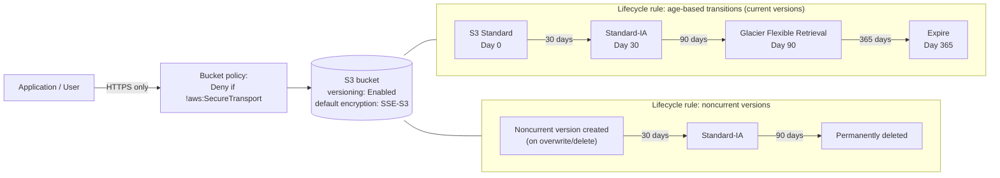

# AWS S3 Storage Lifecycle & Cost Optimization

A versioned S3 bucket with **lifecycle rules** that automatically move objects through cheaper storage classes as they age, a **bucket policy** that enforces HTTPS-only access, and a worked **cost-optimization scenario** comparing the "do nothing" cost against the lifecycle-managed cost. Built while studying the storage portion of the **AWS Certified Cloud Practitioner (CLF-C02)** exam.

> ⚠️ **Status**: this Terraform configuration was hand-written against the AWS provider docs and reviewed manually; `terraform validate`/`apply` have **not** been run — this environment has no Terraform CLI or AWS credentials. Run it yourself following [Setup](#setup).

## Table of contents
- [Learning objectives](#learning-objectives)
- [Use case](#use-case)
- [Architecture](#architecture)
- [Storage classes & this bucket's lifecycle](#storage-classes--this-buckets-lifecycle)
- [Cost-optimization scenario](#cost-optimization-scenario)
- [Why these services](#why-these-services)
- [Repository structure](#repository-structure)
- [Setup](#setup)
- [Testing](#testing)
- [Cleanup](#cleanup)
- [Cost considerations](#cost-considerations)
- [Security notes](#security-notes)
- [Troubleshooting](#troubleshooting)
- [Limitations & future improvements](#limitations--future-improvements)
- [References](#references)

## Learning objectives

After working through this lab you should be able to:
- List the main S3 storage classes and explain the access-pattern/cost tradeoff each one makes (S3 Standard, Standard-IA, One Zone-IA, Glacier Instant/Flexible/Deep Archive, Intelligent-Tiering).
- Explain what S3 **versioning** protects against (accidental overwrite/delete), and what it does *not* protect against (it isn't a backup across accounts/regions by itself).
- Write a **lifecycle configuration** that transitions current objects through storage classes over time, and separately expires old **noncurrent versions** to stop versioning from growing storage costs forever.
- Write a **bucket policy** that denies any request not using TLS (`aws:SecureTransport`), independent of IAM permissions.
- Do a back-of-envelope cost comparison between "leave everything in Standard" and "use a lifecycle policy" for a realistic data volume.

## Use case

A company stores user-uploaded documents (contracts, invoices) in S3. Requirements:
- Documents must be recoverable if accidentally overwritten or deleted for at least 30 days (**versioning**).
- Documents are accessed frequently in the first 30 days, rarely between 30–90 days, and almost never after 90 days, but must be retained for 7 years for compliance (**lifecycle transitions**).
- Nothing in the bucket should ever be reachable unencrypted or publicly (**bucket policy + public access block + default encryption**).

## Architecture



## Storage classes & this bucket's lifecycle

| Storage class | Typical use in this lab | Retrieval |
|---|---|---|
| **S3 Standard** | Days 0–30: documents are newly uploaded and likely to be re-read. | Milliseconds |
| **S3 Standard-IA** | Days 30–90: still needs millisecond access if requested, but access is infrequent — IA has a lower storage price and a per-GB retrieval fee. | Milliseconds |
| **S3 Glacier Flexible Retrieval** | Days 90–365: compliance retention, retrieval is rare and can tolerate minutes-to-hours. | Minutes to hours |
| **Expired (deleted)** | After 365 days (tune to your real retention requirement — 7 years for this lab's compliance scenario, 365 days used here to keep the demo timeline short). | — |

Noncurrent versions (created every time an object is overwritten or "deleted" while versioning is on) follow a **separate, shorter** lifecycle: Standard-IA after 30 days, permanently deleted after 90 — otherwise every edit ever made would be retained in Glacier forever, which defeats the cost optimization.

## Cost-optimization scenario

Assume 100 GB of documents uploaded per month, retained for 2 years, `us-east-1` list prices at the time of writing (check [current S3 pricing](https://aws.amazon.com/s3/pricing/) — these change):

| Approach | Approx. monthly storage cost after 24 months (2,400 GB accumulated) |
|---|---|
| **No lifecycle** — everything stays in S3 Standard | 2,400 GB × ~$0.023/GB ≈ **$55.20/month**, and growing every month with no ceiling. |
| **This lab's lifecycle** — Standard (30d) → Standard-IA (60d) → Glacier (remaining ~22 months) | ~100 GB Standard (~$2.30) + ~200 GB Standard-IA (~$2.50) + ~2,100 GB Glacier Flexible (~$4.20) ≈ **~$9/month** |

That's roughly an **84% reduction** in steady-state storage cost for data that's genuinely accessed less over time — the entire point of lifecycle rules. The exact numbers depend on your real access pattern and region; this is the shape of the argument the CLF-C02 exam expects you to be able to make, not a quote.

## Why these services

| Service | Why it was chosen |
|---|---|
| **S3** | Durable (11 nines), regional object storage with native lifecycle automation — no custom cron job or Lambda needed to "move old files somewhere cheaper." |
| **S3 Versioning** | The simplest protection against accidental overwrite/delete, with no application code changes required. |
| **S3 Lifecycle rules** | Declarative, built into the bucket — the cost optimization in this lab runs itself with zero ongoing operational work. |
| **Bucket policy (`aws:SecureTransport`)** | IAM/ACL permissions don't stop someone from using plain HTTP; only a bucket policy condition does — a classic exam distinction. |

## Repository structure

```
aws-s3-storage-lifecycle/
├── README.md
├── LICENSE
├── .gitignore
├── terraform/
│   ├── main.tf               # Bucket, versioning, lifecycle rules, policy, public access block, encryption
│   ├── variables.tf
│   ├── outputs.tf
│   └── terraform.tfvars.example
├── policies/
│   └── bucket-policy-deny-insecure-transport.json
└── scripts/
    └── demo-versioning.sh    # Uploads, overwrites, and restores an object to show versioning in action
```

## Setup

**Prerequisites**: AWS account, [Terraform](https://developer.hashicorp.com/terraform/install) ≥ 1.5, AWS CLI v2 configured.

```bash
cd terraform
cp terraform.tfvars.example terraform.tfvars
# edit terraform.tfvars: set a globally-unique bucket_name

terraform init
terraform fmt -check
terraform validate
terraform plan
terraform apply
```

## Testing

1. **Versioning**: run `bash scripts/demo-versioning.sh <bucket_name>` — it uploads an object, overwrites it twice, lists all versions with `aws s3api list-object-versions`, and restores the original version by copying it back over the current one. Confirm you can see 3 distinct `VersionId`s.
2. **Lifecycle rule syntax**: `aws s3api get-bucket-lifecycle-configuration --bucket <bucket_name>` and confirm the transition days/classes match the README's [table](#storage-classes--this-buckets-lifecycle). Lifecycle *transitions themselves* run on AWS's internal schedule (typically within 24–48h of the configured day), so you won't see a transition happen live in a short test — the configuration is what you're verifying here.
3. **HTTPS-only enforcement**: `aws s3api get-bucket-policy --bucket <bucket_name>` and confirm the `Deny` statement with `"aws:SecureTransport": "false"` is present. The AWS CLI and SDKs always use HTTPS, so there's no easy way to "fail" this test with the CLI itself — inspecting the policy JSON is the practical check.
4. **Public access block**: `aws s3api get-public-access-block --bucket <bucket_name>` — all four settings should be `true`.

## Cleanup

```bash
cd terraform
# Lifecycle/versioned buckets often aren't empty by the time you destroy —
# empty all versions and delete markers first:
aws s3api list-object-versions --bucket <bucket_name> \
  --query '{Objects: Versions[].{Key:Key,VersionId:VersionId}}' --output json > /tmp/versions.json
aws s3api delete-objects --bucket <bucket_name> --delete file:///tmp/versions.json || true

terraform destroy
```

## Cost considerations

- S3 **storage** is billed per GB-month by storage class (see the [scenario](#cost-optimization-scenario) above); **requests** (GET/PUT/LIST) and **data transfer out** are billed separately and are usually small for a lab like this.
- The Free Tier includes 5 GB of S3 Standard storage and 20,000 GET / 2,000 PUT requests per month for the first 12 months — this lab's test objects stay well within that.
- **Glacier retrieval** has its own per-GB fee and, for Flexible Retrieval, a time delay — don't transition production data you might need back quickly without reading the [retrieval options](https://docs.aws.amazon.com/AmazonS3/latest/userguide/restoring-objects-retrieval-options.html) first.
- Versioning means **every** overwrite keeps the old copy billed until its own lifecycle rule expires it — this is exactly why the noncurrent-version lifecycle rule in this lab exists.

## Security notes

- `block_public_access` is fully enabled — this bucket is never reachable from the public internet regardless of any object ACL.
- Default server-side encryption (SSE-S3, `AES256`) is enforced bucket-wide.
- The bucket policy explicitly denies any request where `aws:SecureTransport` is `false`, closing the "permissions allow it but the transport is insecure" gap that IAM policies alone don't cover.
- `*.tfvars` and `*.tfstate` are gitignored.

## Troubleshooting

| Symptom | Likely cause |
|---|---|
| `terraform apply` fails with `BucketAlreadyExists` | S3 bucket names are globally unique across all AWS accounts — change `bucket_name`. |
| `terraform destroy` fails, bucket not empty | Versioned buckets need every version **and** delete marker removed, not just the current objects — see [Cleanup](#cleanup). |
| `demo-versioning.sh` says `AccessDenied` | Confirm the AWS CLI identity running the script has `s3:PutObject`/`s3:GetObject`/`s3:ListBucket` on the bucket (the Terraform-creating identity normally does by default). |

## Limitations & future improvements

- Lifecycle transition timing in this README is illustrative (30/90/365 days) — tune `lifecycle_*_days` variables to your real retention requirement.
- Could add S3 **Intelligent-Tiering** as an alternative to manually-tuned age-based rules, for access patterns that are hard to predict in advance.
- Could add S3 **Inventory** + **Storage Lens** to make the cost-optimization numbers measurable against real usage instead of estimated.
- No cross-region replication — out of scope for this lab, but a natural follow-up for a durability/DR-focused lab.

## References

- [Amazon S3 Storage Classes](https://aws.amazon.com/s3/storage-classes/)
- [Managing the lifecycle of objects](https://docs.aws.amazon.com/AmazonS3/latest/userguide/object-lifecycle-mgmt.html)
- [Using versioning in S3 buckets](https://docs.aws.amazon.com/AmazonS3/latest/userguide/Versioning.html)
- [Amazon S3 pricing](https://aws.amazon.com/s3/pricing/)
- [AWS Certified Cloud Practitioner (CLF-C02) exam guide](https://d1.awsstatic.com/training-and-certification/docs-cloud-practitioner/AWS-Certified-Cloud-Practitioner_Exam-Guide.pdf)

---
Part of the [aws-cloud-practitioner-portfolio](https://github.com/bboysendo/aws-cloud-practitioner-portfolio) — a set of independent, hands-on AWS labs built while studying for CLF-C02.
